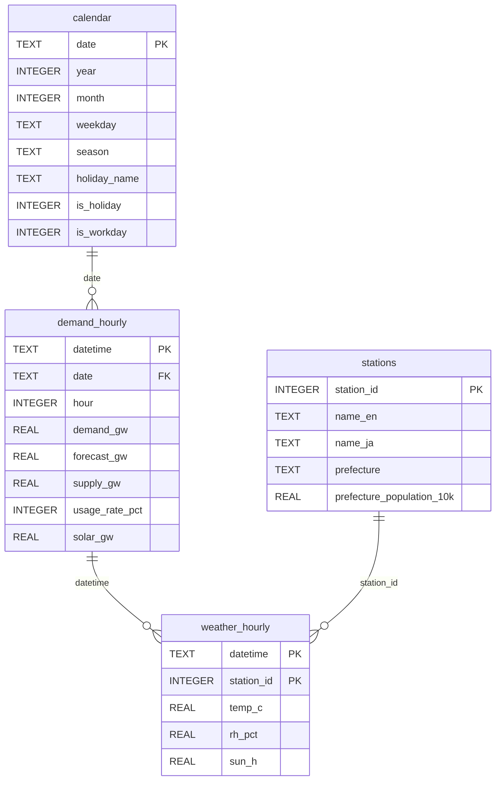

# Tokyo Electricity Demand: SQL Analysis

This project builds a SQLite database from real data on Tokyo electricity demand and Japanese weather, then analyzes it with 16 SQL queries.

**Data:** 39,744 hourly records from 1 Apr 2022 to 12 Oct 2026 (JST).
- **TEPCO Power Grid "でんき予報":** area demand, TEPCO's forecast, supply capacity, usage rate and solar output (GW).
- **Japan Meteorological Agency (気象庁):** hourly temperature, humidity and sunshine at 8 Kanto stations.

Data © TEPCO Power Grid and the Japan Meteorological Agency (processed). It was compiled through [kaseee/tokyo-grid-lab](https://github.com/kaseee/tokyo-grid-lab). Prefecture populations come from the 2020 census.

## Database design



| Table | Rows | Contents |
|---|---:|---|
| `calendar` | 1,656 | One row per day: weekday, season and Japanese holiday name |
| `stations` | 8 | JMA stations: Tokyo, Yokohama, Chiba, Kumagaya, Mito, Utsunomiya, Maebashi, Kofu |
| `demand_hourly` | 39,744 | One row per hour: demand, forecast, supply, usage rate, solar |
| `weather_hourly` | 317,952 | One row per hour per station: temperature, humidity, sunshine |

The tables have primary keys, foreign keys, CHECK constraints and indexes, and the import completes with 0 foreign-key errors.

## SQL features used

| Feature | Queries |
|---|---|
| `SELECT … WHERE … ORDER BY … LIMIT` | q01 top 10 demand hours, q02 hours with tight supply |
| Aggregate functions (`COUNT`, `SUM`, `AVG`, `MIN`, `MAX`) | q03 overall summary, and most other queries |
| `GROUP BY` / `HAVING` | q04 by year, q05 months above 33 GW, q06 peak hour by season |
| `JOIN` (2–4 tables) | q07–q09 with calendar, q10–q12 with weather and stations |
| `CASE` | q07 day type, q10 hot and cold hour counts, q11 temperature bands |
| Subqueries / CTEs (`WITH`) | q06, q12, q14 |
| Window function (`ROW_NUMBER() OVER (PARTITION BY …)`) | q13 peak day of each year |

All queries are in [`queries.sql`](queries.sql), and every result is in [`query_results.md`](query_results.md).

## Key findings

1. **Summer heat sets the record.** All 10 highest-demand hours fell on **2–3 Aug 2022**, between 11:00 and 16:00, with Tokyo at about 33–35 °C. The peak was **59.3 GW**. *(q01)*
2. **Temperature works both ways.** Average demand is lowest at **15–20 °C (26.8 GW)** and almost doubles at **35 °C and above (51.9 GW)**. Cold weather below 5 °C also raises it, to 34.4 GW. *(q11)*
3. **The calendar matters.** Workdays average **33.1 GW**, compared with **28.9 GW** on weekends and holidays. Tuesday is the busiest day and Sunday the quietest. The three Golden Week holidays (Constitution Day, Greenery Day and Children's Day) have the lowest demand of any holiday, at about 22.4 GW. *(q07–q09)*
4. **Supply gets tight in every season, not only summer.** The tightest hour reached **99 % usage, with only 0.37 GW spare**, at 17:00 on 22 Jul 2026. Other hours at 97 % or more include winter mornings (14 Dec 2025, 3 Jan 2026) and early May. *(q02)*
5. **Inland stations are the hottest.** Kumagaya and Maebashi both reached **40.05 °C**. Kumagaya had **644 hours at 35 °C or above**, against 136 for Tokyo and 36 for coastal Chiba. *(q10)*
6. **Solar is reshaping the day.** On spring days, solar covers **34 % of demand at noon**, which lowers the demand left for other power plants to 20.1 GW. Spring also has TEPCO's least accurate forecasts (1.11 % average error). *(q15, q16)*

## Files

All files are in one folder.

| File | Contents |
|---|---|
| `schema.sql` | `CREATE TABLE` statements: keys, constraints, indexes |
| `build_database.py` | Creates `tokyo_electricity.db` and `INSERT`s all rows from the CSV files (Python standard library only) |
| `queries.sql` | The 16 analysis queries, each with the question it answers |
| `run_queries.py` | Runs every query and writes `query_results.md` |
| `query_results.md` | Each question, its SQL and its result table |
| `tokyo_electricity_sql_analysis.ipynb` | Notebook: building the database plus every query with its output. Start here. |
| `demand_hourly.csv.gz`, `weather_hourly.csv.gz`, `stations.csv`, `calendar.csv` | Source data for the four tables |

The database file itself (34 MB) isn't uploaded, because it's larger than GitHub's browser-upload limit. Running `build_database.py` re-creates it in about 3 seconds.

## How to run

```bash
pip install pandas tabulate
python build_database.py     # creates tokyo_electricity.db
python run_queries.py        # runs all queries and writes query_results.md
```

You can also open `tokyo_electricity.db` in any SQLite tool (DB Browser for SQLite, the VS Code SQLite extension, `sqlite3` on the command line) and run the queries from `queries.sql`.
